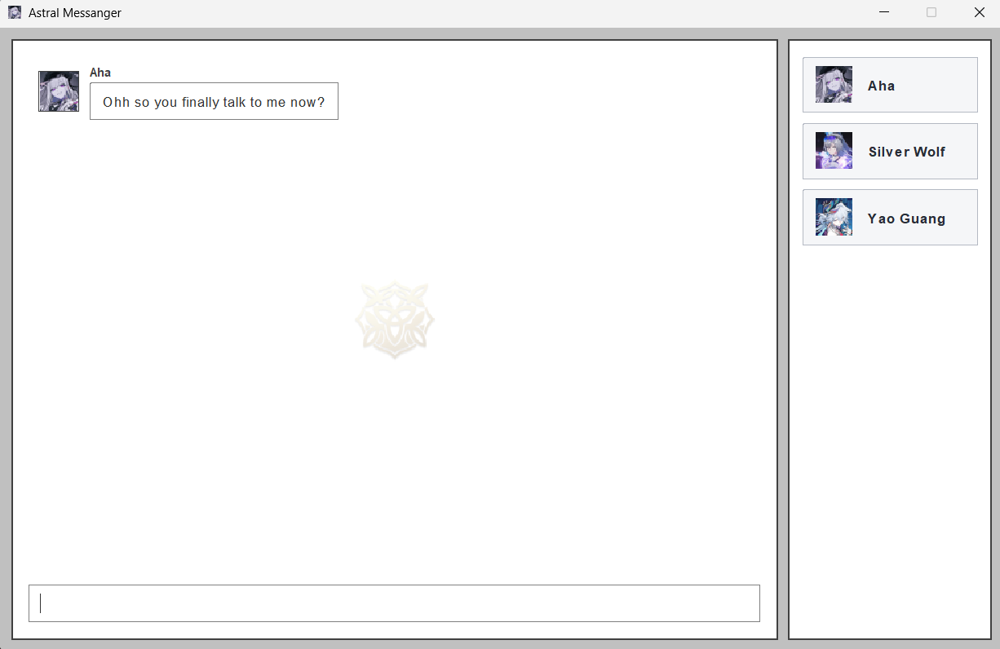

# Astral Messenger — Java Swing GUI Assignment

A desktop instant-messaging UI built with **Java Swing** and **AWT**, created as part of the **Object-Oriented Programming (PBO)** course. The assignment focuses on assembling a GUI from the standard Swing component hierarchy — top-level container, intermediate containers, layout managers, atomic components, and event listeners — instead of on a real messaging backend.

The application simulates a chat window with a conversation area on the left and a contact list on the right. Choosing a contact loads that character's opening message, and every message the user sends is followed by a simulated "typing" indicator and an automatic reply.

## Output



The window after startup: the contact sidebar on the right (`Aha`, `Silver Wolf`, `Yao Guang`), the `Aha` conversation opened in the chat area with its greeting bubble, the `logo.png` watermark behind the messages, and the empty message field at the bottom waiting for input.

## Project Structure

| File | Role |
|------|------|
| `AstralMessege.java` | The whole application: main window, contact sidebar, chat rendering, and event handling. |
| `Assets/icon frame.jpg` | Window icon and the avatar used for the `Aha` contact. |
| `Assets/logo.png` | Transparent logo drawn as the chat-area watermark. |
| `Assets/avatar.jpg` | Avatar representing the user (`Hirsya`). |
| `Assets/siwol.jpg` | Avatar for the `Silver Wolf` contact. |
| `Assets/yaoguang.jpg` | Avatar for the `Yao Guang` contact. |
| `Assets/output.png` | Screenshot of the running application, used in the **Output** section above. |
| `README.md` | This report. |

> The class is spelled `AstralMessege` (double *s*) to match the file name `AstralMessege.java`. Java requires both names to be identical, so the spelling must not be "fixed" in one place only.

## How to Run

Requires a JDK (Java 8 or newer). Swing and AWT ship with the JDK, so there are no external dependencies.

```bash
javac AstralMessege.java
java AstralMessege
```

Run the commands **from this folder**, because images are loaded with the relative path `Assets/<file>`:

```text
GUI Project/
├── Assets/
│   ├── avatar.jpg
│   ├── icon frame.jpg
│   ├── logo.png
│   ├── output.png
│   ├── siwol.jpg
│   └── yaoguang.jpg
├── AstralMessege.java
└── README.md
```

If the program is started from another directory, the icons fail to load and the UI appears without images.

## GUI Component Mapping

The table below maps the assignment's GUI criteria to the actual code in `AstralMessege.java`.

| Criterion | Component | Lines |
|-----------|-----------|-------|
| Frame (top-level container) | `JFrame frame` | 7–16, shown at 156 |
| Intermediate container | `JPanel panelKiri`, `panelKanan`, `chatListPanel`, `panelBawah`, `typingPanel` | 19–43, 46–48, 61–80 |
| Intermediate container | `JPanel` inside `tambahBalonChat` (`barisPesan`, `kotakTeks`) | 183–189 |
| Layout manager | `BorderLayout` | 16, 19 |
| Layout manager | `BoxLayout` (`Y_AXIS`) | 37, 47, 76, 188 |
| Layout manager | `FlowLayout` (`LEFT` / `RIGHT`) | 61, 183 |
| Atomic component | `JButton` (`btnAha`, `btnSilverWolf`, `btnYaoGuang`) | 86–106 |
| Atomic component | `JTextField inputPesan` | 55–60 |
| Atomic component | `JLabel` (typing indicator, name, message text, avatars) | 64–69, 191–211 |
| Event listener | `ActionListener` on contact buttons | 87–106 |
| Event listener | `ActionListener` on `inputPesan` (Enter to send) | 108–144 |
| Event listener | `javax.swing.Timer` for the delayed auto-reply | 122–142 |

### 1. Frame (Top-Level Container)

`JFrame frame` is the main window: title `"Astral Messanger"`, fixed size `1000×650`, non-resizable, custom window icon, and centered on screen with `setLocationRelativeTo(null)`. It uses `EXIT_ON_CLOSE`, so closing the window ends the program.

### 2. Intermediate Containers

- **`panelKiri`** — the conversation area. It is an anonymous `JPanel` subclass that overrides `paintComponent` to draw `logo.png` as a watermark at 25% opacity (`AlphaComposite.SRC_OVER, 0.25f`) in the middle of the panel. Uses `BorderLayout`: messages in `CENTER`, input area in `SOUTH`.
- **`panelKanan`** — the contact sidebar. Fixed preferred width of `200px`, `BoxLayout.Y_AXIS`, holding the three contact buttons separated by `Box.createVerticalStrut(10)`.
- **`chatListPanel`** — vertical `BoxLayout` container holding one message row per message. It is non-opaque so the watermark shows through.
- **`scrollPane`** — `JScrollPane` wrapping `chatListPanel` so long conversations can be scrolled. Border removed, transparent viewport, and scroll unit set to `16` for smoother wheel scrolling.
- **`panelBawah`** — bottom area of the chat, stacking the typing indicator, a `5px` strut, and the text field vertically.
- **`typingPanel`** — left-aligned row containing the typing avatar and the italic `"<name> ..... (typing)"` label. Hidden by default.
- **`barisPesan` / `kotakTeks`** — created per message inside `tambahBalonChat`. `barisPesan` positions the avatar and the text block on the correct side; `kotakTeks` stacks the sender name above the message bubble.

### 3. Layout Managers

- **`BorderLayout(10, 10)`** — on `frame` (chat area in `CENTER`, sidebar in `EAST`) and on `panelKiri` (message list in `CENTER`, input area in `SOUTH`).
- **`BoxLayout.Y_AXIS`** — on `panelKanan`, `chatListPanel`, `panelBawah`, and `kotakTeks`, so children are stacked top to bottom.
- **`FlowLayout`** — on `typingPanel` and `barisPesan`. The alignment is chosen per row: `FlowLayout.RIGHT` for messages sent by the user, `FlowLayout.LEFT` for messages from the contact. This single choice is what produces the classic left/right chat bubble look.

### 4. Atomic Components

- **`JButton`** — the contact buttons, built by `createContactButton(name, iconFile)`. Each button shows a `36×36` icon plus the name, is left-aligned with a `15px` icon gap, uses a hand cursor, and is capped at `55px` height via `setMaximumSize` so `BoxLayout` does not stretch it.
- **`JTextField`** — `inputPesan`, the single-line message input (plain `SansSerif` 14, gray border with inner padding).
- **`JLabel`** — used for the typing avatar and typing text, and inside each bubble for the sender name, the message body, and the avatar. The message body label is opaque and colored differently for the user (warm beige `225, 212, 180`) and the contact (`Color.WHITE`), with rounded line borders to resemble chat bubbles.

### 5. Event Listeners

- **Contact buttons (`ActionListener`)** — each button updates the active character and avatar, clears `chatListPanel` with `removeAll()`, and inserts that character's opening line.
- **Send message (`ActionListener` on `inputPesan`)** — pressing **Enter** triggers it. The text is trimmed and ignored when empty; otherwise it is appended as a right-aligned bubble under the name `Hirsya` with `avatar.jpg`, the field is cleared, and the typing indicator is switched on for the active contact.
- **Auto-reply (`javax.swing.Timer`, `1200 ms`)** — a non-repeating timer hides the typing indicator, picks a reply based on the active character, appends it as a left-aligned bubble, and scrolls to the bottom. `SwingUtilities.invokeLater` is used when moving the scrollbar so the update runs after the layout has been recalculated.

## Class Details

### `AstralMessege.java`

A single class that holds the entire UI. It has no instance fields; all state lives in `main`, in local variables and in two one-element arrays used as mutable holders.

- **Entry point**
  - `main(String[])` — builds every component, wires the listeners, assembles the frame (`panelKiri` in `CENTER`, `panelKanan` in `EAST`), and makes the window visible.
- **Mutable state inside `main`**
  - `karakterAktif` / `avatarAktif` — one-element `String[]` arrays acting as the "currently selected contact" and its avatar file. An array is used instead of a plain variable because local variables captured by a lambda must be effectively final, while the element itself can be reassigned from inside the listeners.
- **Helper methods**
  - `static ImageIcon loadIcon(String fileName, int width, int height)` — loads `Assets/<fileName>` and returns a smoothly scaled `ImageIcon` (`Image.SCALE_SMOOTH`). Used for the window icon, watermark, contact icons, and avatars, so every image goes through one scaling path.
  - `static JButton createContactButton(String namaKarakter, String namaFileIcon)` — factory for the sidebar buttons; keeps the repeated styling (size, font, colors, cursor, border) in one place.
  - `static void tambahBalonChat(JPanel chatListPanel, String namaPengirim, String fileAvatar, String isiPesan, boolean isUser)` — appends one message row. The `isUser` flag decides the `FlowLayout` alignment, the label alignment, the bubble color, and the avatar position. Ends with `revalidate()` and `repaint()` so the new row is laid out and painted immediately.

## Notes on Approach

- **One class, three helpers**: the file is intentionally small and procedural — `loadIcon`, `createContactButton`, and `tambahBalonChat` remove the duplication that would otherwise appear in every message and every contact.
- **Composition over inheritance**: the only inheritance is the anonymous `JPanel` subclass overriding `paintComponent` to paint the watermark behind the chat. Everything else is built by composing standard Swing containers.
- **Layout-driven sizing**: `BoxLayout` would stretch buttons to fill the sidebar height, so `setMaximumSize` caps them at `55px`. Message rows are capped at `75px` for the same reason.
- **Transparency chain**: the watermark is only visible because `chatListPanel`, `scrollPane`, its viewport, and every bubble row are set non-opaque.
- **No real backend**: replies are a `Timer` plus an `if/else` chain in the listener. Each new message creates a new one-shot timer, so replying again never cancels or duplicates an earlier reply.
- **Assets are relative**: images are resolved from `Assets/` relative to the working directory, so the program must be launched from this folder (or from an IDE run configuration whose working directory is this folder).
